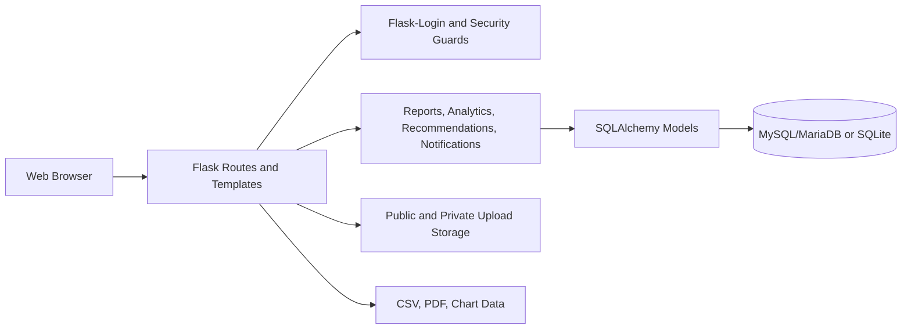
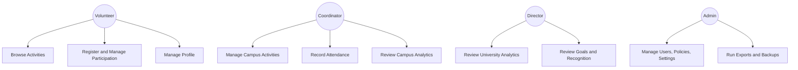
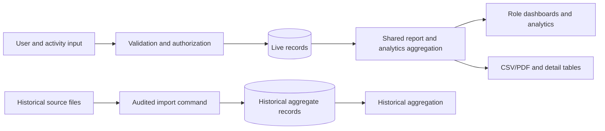
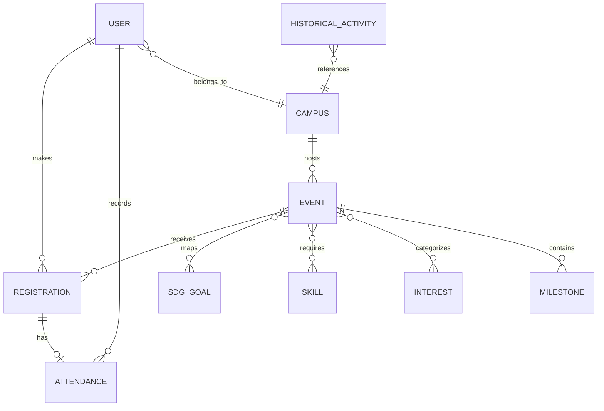
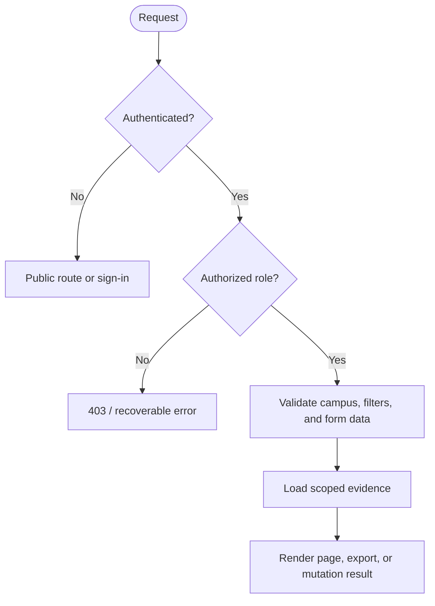

# PSU Volunteer Hub System Documentation

## 1. Title Page

| Item | Details |
|---|---|
| System | PSU Volunteer Hub |
| Developers | PSU Volunteer Hub Development Team |
| Institution | Pangasinan State University (PSU) |
| Date | 1 November 2026 |
| Version | 1.0 |

### Document use

This document is intended for three audiences:

- **Developers:** understand modules, data flow, security boundaries, and extension points.
- **Operators:** install, configure, deploy, back up, and diagnose the service.
- **Users and reviewers:** understand role workflows, analytics meanings, and system limitations.

### Contents

1. Introduction
2. System Overview
3. System Requirements
4. System Architecture
5. System Design
6. System Development
7. Database Documentation
8. System Implementation
9. System Testing
10. User Manual
11. Security Documentation
12. System Maintenance
13. Conclusion
14. Appendices

The numbered headings below follow the project documentation specification.

## 2. Introduction

### Project background

PSU Volunteer Hub is a web-based volunteer-management platform for Pangasinan
State University. It connects volunteers with campus activities and gives
coordinators, directors, and administrators a shared source of operational and
impact information.

### Problem statement

Volunteer activity information, registration records, attendance evidence,
campus goals, and reports are difficult to manage consistently when they are
distributed across spreadsheets, paper records, and separate communication
channels. PSU needs one system with campus isolation, auditable attendance,
role-based workflows, and useful analytics.

### Objectives

- Let volunteers discover activities, register, manage their profiles, and view participation history.
- Let Coordinators publish activities, manage registrations, record attendance, and monitor campus operations.
- Let Directors compare campuses, review goals, recognition, calendars, and analytics.
- Let Admins manage users, categories, policies, settings, backups, and audit records.
- Provide reliable descriptive and prescriptive analytics without changing counting rules or fabricating historical records.

### Scope and limitations

The system covers live volunteer activities, registrations, attendance, campus
goals, reports, notifications, policies, user administration, and imported
historical aggregate reports. Historical records are aggregate institutional
records, not individual users or attendance rows. Email delivery, capacity
forecasting, recurring reminders, task workflows, and automatic database
migrations are outside the application scope.

### Target users

Volunteers, campus Extension Coordinators, university-wide Extension Directors,
and system Administrators.

## 3. System Overview

### Description

The application is a server-rendered Flask web application backed by a
relational database. It uses native HTML forms and disclosures, server-side
pagination, role-scoped routes, and accessible fallback tables for charts.

### Key features

- Public opportunity search and volunteer registration.
- Campus-scoped activity creation, editing, cancellation, announcements, milestones, and attendance.
- Registration, cancellation, attendance, and certificate workflows.
- Annual campus goals and evidence tracking.
- Director/Admin live and historical analytics with filters and CSV/PDF exports.
- Coordinator and Director dashboards with calendars, KPI summaries, follow-ups, and guidance.
- Fixed catalogue of nine PSU campuses and campus-specific registration affiliations.
- Admin user/category management, password resets, policies, notifications, imports, exports, backups, and audit logs.
- Cosine-similarity activity recommendations for volunteers.

### User roles

| Role | Main responsibilities | Analytics scope |
|---|---|---|
| Volunteer | Browse, register, cancel eligible registrations, manage profile | Personal participation only |
| Coordinator | Manage activities and attendance for one campus | Own campus; campus filters are enforced server-side |
| Director | Review university delivery, goals, recognition, and cross-campus comparisons | University-wide or selected campus scope |
| Admin | Govern users, policies, configuration, and data operations | Shared university analytics and administration |

### Permission model at a glance

Permissions are enforced in the route layer and repeated in query scopes. A
hidden button or filtered dropdown is never treated as authorization. Every
mutation validates the current user, campus ownership, CSRF token, submitted
record identifiers, and the current database state before committing.

| Capability | Volunteer | Coordinator | Director | Admin |
|---|---:|---:|---:|---:|
| Browse public activities | Yes | Yes | Yes | Yes |
| Register for activities | Yes | As permitted | As permitted | As permitted |
| Create/edit activities | No | Own campus | No | Administrative workflows only |
| Record attendance | No | Own campus | Review | Review/governance |
| View campus analytics | Personal only | Own campus | All campuses | University scope |
| Manage users and settings | No | No | No | Yes |
| Export university reports | No | Campus scope where enabled | Yes | Yes |

### Technology stack

- Python 3.10+, Flask 3, Flask-SQLAlchemy, Flask-Login, Flask-WTF.
- MySQL/MariaDB in shared environments; SQLite for isolated development/tests.
- Werkzeug password hashing, PyMySQL/mysqlclient, python-dotenv.
- pandas, NumPy, scikit-learn, Plotly, Matplotlib, Pillow, and ReportLab.
- Gunicorn for Linux/WSGI deployment; pytest for automated testing.

### External boundaries

The application can use an email provider for password recovery and operational
messages, but remains usable without email for in-app notifications and
administrative password resets. Hosting, DNS, provider credentials, object
storage, and database services are deployment concerns and are not hard-coded.

## 4. System Requirements

### Functional requirements

1. Authenticate users and enforce role permissions.
2. Maintain volunteers, campuses, categories, activities, registrations, and attendance.
3. Support campus-scoped Coordinator operations.
4. Produce live and historical analytics with filters and exports.
5. Record policies, notifications, audit events, goals, and milestones.
6. Preserve exact counts, empty states, provisional attendance labels, and report pagination.

### Non-functional requirements

- Secure password hashing, CSRF protection, validation, authorization, and session invalidation.
- Accessible keyboard operation, visible focus, semantic controls, 44px targets, responsive layouts, and chart fallback tables.
- Idempotent seed/import commands and no silent deletion or reassignment of user data.
- Maintainable Python modules, shared helpers, tests, and documented operational procedures.

### Quality attributes

| Attribute | Implementation approach |
|---|---|
| Correctness | Shared report evidence, exact integer counts, deterministic ordering, and regression tests |
| Security | Role guards, campus isolation, CSRF, password hashing, throttling, audit logs, and safe exports |
| Accessibility | Semantic headings/labels, native controls, visible focus, keyboard support, contrast, and fallback tables |
| Performance | Pagination, scoped queries, aggregation helpers, bounded recommendation candidates, and controlled export queries |
| Recoverability | Transaction rollback, idempotent initialization/import commands, backups, and explicit configuration errors |
| Maintainability | Centralized constants/helpers, predictable route contexts, QA evidence, and minimal dependencies |

### Hardware requirements

For development: a modern dual-core computer, 4 GB RAM, 10 GB free storage,
and a current browser. For production, size CPU, memory, storage, and database
capacity according to concurrent users, activity volume, uploaded files, and
backup retention.

### Software requirements

Python 3.10+, MySQL 8/MariaDB 10.4+ for shared deployment, Git, a supported
browser, environment variables for secrets/database/email, and the packages in
`requirements.txt`.

## 5. System Architecture

### Architecture diagram



### Components

- `app/__init__.py`: application factory, configuration, initialization, security guards, and seed hooks.
- `app/routes/`: role and workflow endpoints.
- `app/models/`: SQLAlchemy entities and relationships.
- `app/reports.py`: shared filtered evidence/report construction.
- `app/recommendation/analytics.py`: descriptive analytics aggregation and forecasts.
- `app/recommendation/engine.py`: volunteer activity recommendations.
- `templates/`: server-rendered UI and shared partials.
- `static/`: PSU styles, interaction scripts, chart helpers, and confirmation behavior.

### Data flow

1. A request enters a role-protected route.
2. Query parameters and form values are validated, including campus scope.
3. A report/evidence query builds the selected record set.
4. KPI, chart, table, export, and recommendation contexts reuse that scope.
5. The template renders HTML; optional JavaScript enhances charts and dependent controls.
6. Mutations commit through SQLAlchemy and create audit/notification records where applicable.

### Request lifecycle

1. Flask creates or reuses the application context.
2. Session and authentication middleware resolve the current user.
3. Request-level campus validation rejects unsupported campus identifiers.
4. Route decorators enforce login and role requirements.
5. The route parses supported query/form keys and normalizes values.
6. SQLAlchemy queries apply role and campus scope before records are rendered.
7. Mutations validate business rules, write audit/notification data, and commit atomically.
8. Errors roll back the transaction and return a recoverable page or redirect.

## 6. System Design

### Use case diagram



### Data flow diagram



### Entity relationship diagram



### System flowchart



### Database schema overview

The schema is relational and uses foreign keys for user, campus, activity,
registration, attendance, policy, notification, audit, and historical records.
Junction tables normalize skills, interests, SDGs, and event relationships.

### UI design

The UI uses PSU blue, PSU gold, neutral surfaces, shared buttons/forms, native
`details/summary` disclosures, responsive grids, compact pagination, labelled
scroll regions, and server-rendered fallback data. QA evidence is organized in
[`docs/qa/`](qa/), while current handoff information remains in
[`HANDOFF.md`](../HANDOFF.md).

## 7. System Development

### Methodology

Incremental, test-driven feature development with focused regression checks,
shared helpers, role-scope review, accessibility review, and documented QA
evidence. Small changes reuse existing components and avoid unnecessary
dependencies or schema changes.

### Languages, frameworks, and libraries

Python, Jinja2/HTML, CSS, JavaScript, Flask, SQLAlchemy, Flask-Login,
Werkzeug, scikit-learn, pandas/NumPy, Plotly/Matplotlib, ReportLab, and pytest.

### Folder structure

```text
app/                  Application factory, models, routes, services
templates/            Jinja templates and shared partials
static/               CSS, JavaScript, and public assets
tests/                Automated regression and focused feature tests
migrations/           Versioned database migrations
docs/qa/              Feature and UI verification records
docs/operations/      Deployment, backup, and production runbooks
docs/planning/        Roadmap and release notes
Database/             Database setup documentation
```

### Major modules

- Authentication and password recovery (`app/routes/auth.py`).
- Administration (`app/routes/admin.py`).
- Coordinator operations (`app/routes/coordinator.py`).
- Director dashboards and analytics (`app/routes/director.py`).
- Activities and registration workflows (`app/routes/events.py`).
- Goals (`app/annual_goals.py`, `app/routes/goals.py`).
- Reporting (`app/reports.py`).
- Analytics (`app/recommendation/analytics.py`).
- Recommendations (`app/recommendation/engine.py`).

### Algorithms

- Exact-ratio annual-goal campus ranking with ties retained.
- Attendance and registration aggregation over filtered live evidence.
- Cosine similarity over normalized volunteer skill/interest and activity terms.
- Participation-history category boost for recommendations.
- Linear regression turnout forecast for Coordinator planning.
- Server-side pagination and deterministic ordering for reports and administration.

## 8. Database Documentation

### Core tables and fields

| Table | Important fields | Keys and purpose |
|---|---|---|
| `users` | `id`, `name`, `email`, `role`, `campus_id`, `college_affiliation`, `password_hash`, `is_active` | PK `id`; FK `campus_id` |
| `campuses` | `id`, `name`, `code`, `description` | PK `id`; unique code; fixed nine-campus catalogue |
| `events` | `id`, `title`, `date`, `end_date`, `category`, `slots`, `target_participants`, `campus_id`, `created_by_id` | PK `id`; FKs to campus/users |
| `registrations` | `id`, `user_id`, `external_participant_id`, `event_id`, `status`, `registered_at` | PK `id`; FKs to user/external/event; unique participant-event constraints |
| `attendance` | `id`, `registration_id`, `user_id`, `event_id`, `status` | PK `id`; one attendance row per registration |
| `external_participants` | `id`, `id_number`, `name`, contact fields | PK `id`; non-login participants |
| `activity_categories` | `id`, `name` | PK `id`; unique name |
| `sdg_goals` | `id`, `number`, `name` | PK `id`; official SDG catalogue |
| `historical_activities` | source metadata, `unit_name`, `campus_id`, `volunteer_count`, `year_conducted` | PK `id`; aggregate historical source rows |
| `annual_goal_*` | indicators, targets, proposals, evidence | Goal and campus foreign keys |
| `notifications` | recipient, title/message, read state, timestamps | Recipient and audit references |
| `audit_logs` | actor, action, subject, metadata, timestamp | Immutable operational history |
| `system_settings` | `key`, `value` | Operational configuration, including affiliations |

### Data dictionary rules

- IDs are integer primary keys.
- Campus relationships use foreign keys and the fixed official catalogue.
- Registration status is pending, confirmed, completed, or cancelled.
- Attendance status is present, absent, or excused.
- Historical counts are aggregate source values and must not be treated as unique people.
- Passwords are stored as hashes, never plaintext.

## 9. System Implementation

### Installation

```powershell
python -m venv .venv
.\.venv\Scripts\Activate.ps1
pip install -r requirements.txt
$env:DATABASE_URL="sqlite:///psu_local.db"
$env:FLASK_APP="app:create_app"
flask run --port 5000
```

Use MySQL/MariaDB and a dedicated application account for shared deployment.

### Environment configuration

Set `DATABASE_URL`, a strong `SECRET_KEY`, environment name, upload paths,
trusted proxy settings, and email provider settings where applicable. Never
commit secrets or database exports.

### Database setup

For a fresh development database, use the project initialization commands. The
fixed catalogue creates the nine official campuses. For an existing database,
run the documented campus-catalogue synchronization command and resolve any
unsupported custom campus records before normal startup.

### Server and deployment

Use `wsgi:app` with Gunicorn on Linux. Configure HTTPS, persistent private and
public storage, MySQL/MariaDB, backups, health checks, and email delivery. See
[`docs/operations/RAILWAY_DEMO_DEPLOYMENT.md`](operations/RAILWAY_DEMO_DEPLOYMENT.md)
for deployment boundaries.

## 10. System Testing

### Methodology

Testing combines pytest unit/integration tests, chart tests, template checks,
isolated SQLite fixtures, focused browser checks, responsive layout checks, and
manual accessibility review. Tests cover role isolation, exact counts, empty
states, pagination, filters, exports, and security boundaries.

### Representative test cases

| Case | Expected result | Actual result |
|---|---|---|
| Valid volunteer registration | Account is created with campus and affiliation | Passed in focused auth tests |
| Mismatched campus affiliation | Registration is rejected with a field error | Passed in fixed-campus tests |
| Coordinator opens another campus activity | Access is denied or filtered to own campus | Covered by coordinator scope tests |
| Director filters analytics by campus/category/date | KPIs, charts, rows, and exports agree | Covered by report/dashboard tests |
| Invalid pagination page | Page clamps to first/last valid page | Covered by dashboard/admin tests |
| Incomplete attendance | Attendance rate remains unavailable/provisional | Covered by dashboard/report tests |
| Unauthorized admin action | Authorization/CSRF protection blocks mutation | Covered by security tests |
| Empty result set | “No matching records” is distinct from zero counts | Covered by analytics UI tests |

### Bugs and fixes

The project QA records document repaired issues including campus-scope leakage,
pagination state loss, attendance timing, cancellation decisions, duplicate
submits, password-reset handling, fixed-campus validation, and responsive UI
alignment. Review the relevant file in `docs/qa/` before changing behavior.

### Test summary

Run focused tests with:

```powershell
.\.venv\Scripts\python.exe -m pytest -q -p no:cacheprovider
git diff --check
```

The exact current evidence and environment limitations are recorded in the QA
documents and `HANDOFF.md`; counts from historical snapshots should not be
treated as a new release result.

## 11. User Manual

### Login

1. Open the PSU Volunteer Hub URL.
2. Enter institutional email or PSU ID and password.
3. Complete any required policy or profile step.
4. Use the role-specific navigation shown after sign-in.

### Dashboard navigation

- Volunteers use opportunities, registrations, recommendations, history, and profile.
- Coordinators use Manage Activities, attendance, follow-ups, calendar, and campus analytics.
- Directors use annual goals, Performance Overview, recognition, calendar, Cross-Campus Comparison, and Analytics.
- Admins use Dashboard, Settings, Help, user/category administration, policies, imports, exports, notifications, and backups.

### Common feature instructions

- **Create an activity:** choose a category, campus (where permitted), dates, capacity/target, description, and required policies; save and review the resulting activity.
- **Register:** open an activity, review requirements, accept required agreements, and submit. Registration status appears in My Registrations.
- **Record attendance:** Coordinators open the campus activity, select attendance status, complete required records, and save.
- **Use analytics:** select the period and filters, review KPI definitions and exact rows, expand detail sections, and export CSV/PDF when needed.
- **Manage users:** Admins search/filter users, edit roles/campus/affiliation, deactivate/reactivate, or reset a password with confirmation.
- **Use the calendar:** navigate months, select an activity, and follow its report/manage link according to role.

### Screenshots

UI screenshots and responsive/manual evidence are kept in the feature QA
documents under `docs/qa/`. The system intentionally uses the live templates
as the authoritative UI reference rather than embedding stale screenshots here.

### Troubleshooting

- If a page shows no data, confirm the selected period, campus, category, and status filters.
- If attendance rate is unavailable, ended activities may still have incomplete attendance or registration evidence.
- If a campus is rejected, use one of the nine official PSU campuses.
- If a password is rejected, use the required length plus uppercase, lowercase, number, and special character.
- If exports differ from expectations, clear filters and verify the selected scope before exporting.
- Contact an Admin for account lockout, policy, campus-catalogue, or configuration issues.

## 12. Security Documentation

- **Authentication:** Flask-Login sessions, password hashing, password reset tokens, throttling, session invalidation after password changes, and policy gates.
- **Authorization:** route decorators and server-side campus checks protect role and record access.
- **RBAC:** Volunteer, Coordinator, Director, and Admin capabilities are distinct; Coordinator queries are campus-isolated.
- **Password protection:** minimum configured length plus uppercase, lowercase, number, and special-character requirements for entered passwords. Password hashes are never exported.
- **Data validation:** CSRF tokens, fixed campus catalogue validation, form validation, safe filter parsing, duplicate checks, and server-side recomputation of sensitive actions.
- **Backups and recovery:** documented database/upload backup and restore procedures; production backups must be encrypted, retained, and restore-tested.

## 13. System Maintenance

### Procedures

Review logs, health checks, failed jobs, audit events, disk space, database
growth, uploads, and email delivery. Run focused regressions before releases.

### Database backup

Use the operational backup runbook in `docs/operations/`, protect credentials,
encrypt off-site copies, and test restoration in a separate environment.

### Updates

Create a branch, review migrations and dependencies, run focused and full tests,
perform accessibility/browser checks, document results, then deploy through the
approved environment process.

### Error handling

The application uses recoverable validation errors, role-aware 403/404 responses,
transaction rollback, flash messages, audit events, and explicit empty/error
states. Do not expose secrets or raw database traces to users.

### Known limitations

Historical data is aggregate; forecast outputs are descriptive planning aids;
native screen-reader/physical-device checks still require release-specific
verification; and production operations require configured external backups,
email, HTTPS, and monitoring.

## 14. Conclusion

PSU Volunteer Hub centralizes volunteer activity delivery, attendance evidence,
campus coordination, governance, and descriptive analytics. The implemented
objectives include role-based workflows, fixed campus scope, auditable records,
accessible dashboards, exports, recommendations, and maintainable operational
documentation. Remaining work includes deeper production monitoring, restore
automation, richer forecasting, and additional institution-approved analytics.

## 15. Appendices

### Source-code reference

- Application factory: `app/__init__.py`
- Models: `app/models/`
- Role routes: `app/routes/`
- Reports: `app/reports.py`
- Analytics: `app/recommendation/analytics.py`
- Recommendations: `app/recommendation/engine.py`
- Templates: `templates/`
- Tests: `tests/`

### Analytics appendix

#### KPI definitions and formulas

| KPI | Definition/formula | Notes |
|---|---|---|
| Activities | Count of activities in the selected report scope | Uses activity start date and active filters |
| Registrations | Count of non-cancelled registrations in scope | External and PSU records are retained in appropriate totals |
| Verified Attendance | Count of present attendance records | Provisional/incomplete records are labelled |
| Attendance rate | `verified present attendance / eligible registrations × 100` | Only complete ended activity evidence is eligible |
| Targets reached | Activities/participants meeting positive configured targets | Unavailable when target or demographic scope makes comparison ineligible |
| Retention rate | `confirmed or completed registrations / all registrations × 100` | Used by the analytics aggregator; it is registration-based, not a unique-person cohort metric |
| No-show count | Eligible registrations without a present attendance result, subject to completion rules | Cancelled registrations are excluded |

#### Attendance and no-show calculations

Attendance is based on registration-linked attendance rows. `present` is
verified attendance; `absent` and `excused` are not present. Cancelled
registrations are excluded. Ended activities with missing attendance are not
used to claim a final attendance rate; the UI shows an unavailable/provisional
state instead.

#### Volunteer retention

The current retention KPI uses confirmed or completed registrations divided by
all registrations in the same scope. It is a participation-completion ratio,
not a deduplicated person-retention cohort. A future cohort-retention feature
would need an approved definition and period model.

#### Recommendation algorithm

Volunteer recommendations normalize skills, interests, event categories, and
required skills, apply curated synonym mappings, construct binary term vectors,
and calculate cosine similarity:

`similarity = shared normalized terms / sqrt(user terms × event terms)`

Previously joined categories receive a capped 0.15 boost. Already registered
activities are excluded, candidates are ordered by score, and the top five are
shown. Cold-start users receive a deterministic fallback recommendation set.

#### Analytics data sources

- Live `events`, `registrations`, `attendance`, `users`, `campuses`, categories, SDGs, and goals.
- Historical `historical_activities` imported from audited source documents.
- Profile skills/interests for volunteer recommendations.
- System settings and policy records for operational context.

#### Data processing workflow

```text
Request filters -> validate role/campus scope -> build evidence query
-> calculate KPIs and comparison period -> group by campus/category/time
-> render charts + fallback tables -> paginate detail rows
-> export the same unpaginated filtered scope when requested
```

All live analytics outputs should reuse the same filtered evidence and preserve
scope, filter, pagination, and anchor query parameters.

#### Role-based analytics access

- Volunteers see personal participation and recommendation data.
- Coordinators see their own campus and cannot broaden campus filters.
- Directors see university-wide comparisons, campus coverage, goals, recognition, and detailed reports.
- Admins retain shared university analytics and governance visibility.

### References

- Project `README.md`, `HANDOFF.md`, and `docs/qa/` evidence.
- Flask, SQLAlchemy, Flask-Login, Werkzeug, scikit-learn, Plotly, ReportLab, and pytest documentation.
- Pangasinan State University campus and college-affiliation catalogue maintained by the application.

### Requirement-to-implementation traceability

| Requirement area | Primary implementation | Verification source |
|---|---|---|
| Authentication and password recovery | `app/routes/auth.py`, `app/security.py`, `app/models/user.py` | `tests/test_password_recovery.py`, `tests/test_security_remediation.py` |
| Fixed PSU campus catalogue | `app/campuses.py`, `app/__init__.py` | `tests/test_fixed_campuses.py`, `docs/qa/FIXED_CAMPUS_QA.md` |
| Activity and attendance operations | `app/routes/coordinator.py`, `app/routes/events.py` | coordinator and attendance regression tests |
| Director goals and comparisons | `app/annual_goals.py`, `app/routes/director.py` | dashboard and campus-ranking tests |
| Analytics and exports | `app/reports.py`, `app/recommendation/analytics.py` | report/query/chart tests and QA records |
| Recommendations | `app/recommendation/engine.py` | recommendation tests and volunteer workflow checks |
| Admin governance | `app/routes/admin.py`, policy/audit/notification models | admin, policy, import/export, and notification tests |
| Responsive UI | `templates/`, `static/styles/`, `static/scripts/` | role browser and feature QA documents |

### Change-management checklist

Before merging a feature:

1. Define the user-visible behavior and affected roles.
2. Confirm whether a schema or migration is genuinely necessary.
3. Reuse the shared report, campus, authorization, and UI helpers.
4. Add focused tests for success, denial, empty, zero, and boundary states.
5. Run `git diff --check`, focused pytest tests, and relevant chart/browser checks.
6. Review keyboard, focus, contrast, mobile reflow, and page overflow behavior.
7. Update the relevant QA note and `HANDOFF.md` when scope or verification changes.
8. Review secrets, exports, logs, migrations, and unrelated work before commit.

### Operational runbook summary

| Situation | First action | Escalation |
|---|---|---|
| Login failures | Check account status, throttling, and policy prompts; do not inspect plaintext passwords | Admin/security owner |
| Missing campus option | Verify the fixed catalogue and initialization command | Database/operator owner |
| Wrong analytics total | Reproduce with filters, compare evidence rows and export, then inspect report scope | Analytics maintainer |
| Attendance rate unavailable | Check ended activity state, registrations, and completion of attendance records | Coordinator/Director |
| Export failure | Re-run with a narrow scope, inspect logs, and preserve the original filters | Operations owner |
| Slow page | Check query count, pagination, scope size, and database indexes before increasing timeouts | Backend owner |
| Suspected unauthorized access | Preserve audit/log evidence, revoke sessions if needed, and review role/campus checks | Security owner |

### Analytics governance notes

Analytics are decision support, not an automatic performance verdict. A rate
must be shown as unavailable when the underlying evidence is incomplete. A zero
must remain visibly different from no matching records. Historical aggregate
counts must not be merged with live unique-person counts. Filters, exports,
charts, fallback tables, and detail pagination must use the same selected scope.

Recommendations describe operational next steps and must not imply blame when
attendance, target, demographic, or historical evidence is incomplete. Directors
may send an in-app reminder only through the authorized action; equivalent unread
reminders should not be duplicated.

### Analytics classification

PSU Volunteer Hub uses three complementary types of data analytics. They are
presented together so users can move from a reliable summary, to evidence about
the cause, to an actionable next step.

#### Descriptive analytics — What happened?

Descriptive analytics summarize observed records for a selected period and
scope. They do not claim why a result occurred.

| Example | Data used | Output location |
|---|---|---|
| Activities, registrations, and verified attendance totals | `events`, `registrations`, `attendance` | Performance Overview and Analytics KPI strip |
| Attendance rate and previous-period comparison | Eligible ended activities and complete attendance records | Dashboard and Analytics |
| Campus/category participation comparison | Filtered live evidence grouped by campus or category | Participation Breakdowns |
| Monthly/weekly engagement trends | Activity dates, registrations, and present attendance | Analytics trend charts and tables |
| Recognition rankings | Verified present records, completed activities, annual goal evidence | Director dashboard |
| Historical participation | Imported aggregate `historical_activities` rows | Historical Analytics |

#### Diagnostic analytics — Why did it happen?

Diagnostic analytics help users investigate a descriptive result by slicing the
same evidence by campus, date, category, activity name, status, demographic,
affiliation, and attention state. They show contributing records and data
quality conditions; they do not infer causation beyond the available evidence.

| Diagnostic question | Evidence or breakdown | User action |
|---|---|---|
| Why is attendance rate unavailable? | Ended activities with incomplete or provisional attendance | Complete attendance records before interpreting the rate |
| Which campuses contribute to the total? | Campus comparisons, coverage tiles, and campus attendance outcomes | Open the filtered campus report |
| Which activities need attention? | Activity rows with missing attendance, missed targets, or low attendance | Review or complete the affected activity |
| Where did registration conversion weaken? | Registrations versus verified attendance by activity/category/campus | Review outreach, reminders, and participant confirmation |
| Are results affected by scope? | Active-filter summary, demographic scope, selected period, and historical/live source label | Change filters or open the detailed report |

Diagnostic views preserve exact counts, distinguish zero from no matching
records, and expose the supporting rows used by the KPI whenever possible.

#### Prescriptive analytics — What should happen next?

Prescriptive analytics convert current evidence into a recommended operational
response. Recommendations are live presentation guidance: they update when the
underlying condition changes and disappear when it is resolved. They do not
create recurring tasks or claim that a campus is at fault when evidence is
incomplete.

| Triggering signal | Prescriptive guidance | Destination/action |
|---|---|---|
| Incomplete ended attendance | Complete outstanding attendance so verified results can be assessed | Coordinator completes attendance; Director reviews activity |
| No approved campus targets | Submit or review campus goal proposals | Goal workspace |
| Fully recorded activity missed a positive participant target | Review the target and plan participant outreach | Affected activity report |
| Fully recorded activity has attendance below the 75% review guide | Review reminders, participant confirmation, and outreach | Affected activity report |
| No campus activity in the selected reporting period | Plan or publish a campus activity | Create Activity or campus report |
| Approved annual goals remain unmet | Review remaining goals and agree on the next evidence/activity milestone | Campus goal details; optional in-app Coordinator reminder |

The priority order is incomplete attendance, missing targets, missed participant
targets, low attendance/conversion, no activities, and remaining annual goals.
Multiple signals show one primary recommendation followed by up to two additional
tips. Directors can optionally notify active Coordinators through the existing
in-app notification system; equivalent unread reminders are suppressed.

#### Analytics type by role

| Role | Descriptive | Diagnostic | Prescriptive |
|---|---|---|---|
| Volunteer | Personal registrations, attendance, and history | Personal recommendation context and registration status | Recommended activities based on skills/interests |
| Coordinator | Campus totals, attendance, trends, and calendar | Activity-level evidence, filters, incomplete records, and target gaps | Complete attendance, outreach, scheduling, and readiness guidance |
| Director | University KPIs, campus comparisons, goals, recognition, and trends | Cross-campus evidence, detailed reports, filters, and exports | Campus follow-up guidance and optional Coordinator reminders |
| Admin | Shared university analytics and system activity | Governance, audit, filters, and source-quality review | Operational remediation guidance; Admin does not receive Director-only campus reminders |

### Accessibility review checklist

- Every form control has an associated label and useful error text.
- Focus remains visible and does not rely on color alone.
- Interactive targets are at least 44px where practical.
- Native `details/summary`, buttons, links, tables, and headings retain semantics.
- Charts have legends, measure labels, exact values, and a non-JavaScript table/fallback.
- Long campus/activity names wrap without page-level horizontal overflow.
- Mobile filters stack intentionally; tables scroll inside labelled regions.
- Empty, loading, error, disabled, selected, and success states are distinguishable.

### Release acceptance checklist

- [ ] Environment variables and secrets are configured outside source control.
- [ ] Database backup and restore procedure has been tested in a separate target.
- [ ] Migrations and fixed-campus catalogue state are reviewed.
- [ ] Focused tests and relevant full regressions pass.
- [ ] CSV/PDF export scope agrees with visible report scope.
- [ ] Role and campus isolation checks pass.
- [ ] Browser checks cover desktop, mobile, keyboard, focus, overflow, and error states.
- [ ] QA and handoff documents describe actual results and remaining limitations.
- [ ] Deployment health, logs, email, storage, and rollback plan are ready.

### Glossary

| Term | Meaning |
|---|---|
| AOP / ASP | Annual goal plan categories used by PSU |
| KPI | Key Performance Indicator |
| PSU | Pangasinan State University |
| SDG | Sustainable Development Goal |
| Verified attendance | Registration-linked attendance marked `present` |
| Provisional attendance | Attendance evidence not yet complete enough for a final rate |
| Live analytics | Metrics calculated from current activity records |
| Historical analytics | Aggregate metrics imported from prior institutional reports |
| Campus isolation | Server-side restriction preventing cross-campus Coordinator access |
